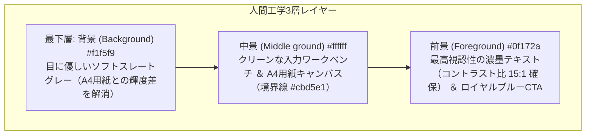

# ShoruiFlow (書類フロー) 決定論的デザインシステム (DESIGN.md)
*Web UI/UX実践ガイドライン（人が見やすく使いやすいプロダクトの構築原則）完全準拠*

---

## 1. デザイン理念：人間工学に基づいた「見やすさ」「目の疲労ゼロ」「脱AI感」

「暗すぎる漆黒背景と眩しい真っ白なA4用紙の激しい明暗差（グレア現象）」による目の疲労を根本的に解決します。
世界水準のプロフェッショナルSaaS（Linear, Stripe, Notion, Figma）が採用する**人間工学的ライトスレート・クリーンパレット**を基調とし、長時間の書類作成業務でも目が疲れず、1文字1文字がクリアに視認できる配色設計を確立します。

---

## 2. 視覚的階層（Visual Hierarchy）と3層レイヤー構造

---

## 3. 配色設計規約（見やすさ特化セマンティックカラー）

| トークン名 | カラーコード (Light) | カラーコード (Dark) | 役割・視認性設計 |
| :--- | :--- | :--- | :--- |
| `--color-bg-base` | `#f1f5f9` (Soft Slate) | `#0f172a` | 作業台の背景。A4用紙との明暗差を滑らかにし、グレア疲労を防止 |
| `--color-surface` | `#ffffff` (Pure White) | `#1e293b` | 入力パネル、カードコンテナ。明瞭な情報区切り |
| `--color-surface-sunken`| `#f8fafc` | `#0b1320` | 入力フィールド。フォーカス時に白へ変化し入力中の現在地を明示 |
| `--color-border` | `#cbd5e1` | `#334155` | 繊細で明瞭な1px境界線 |
| `--color-text-main` | `#0f172a` (Deep Slate) | `#f8fafc` | 本文・入力値。最高コントラスト比（15:1）で文字滲みを排除 |
| `--color-text-sub` | `#475569` (Muted Slate)| `#cbd5e1` | ラベル・補助注記。WCAG AAA基準（7:1）をクリア |
| `--color-action-accent` | `#2563eb` (Royal Blue) | `#3b82f6` | **Action Accent:** 単一の最重要CTA（PDF印刷・保存）に限定集中 |
| `--color-header-bg` | `#0f172a` (Navy) | `#0a0d14` | ヘッダーツールバー。作業領域とナビゲーションの明瞭な分離 |

---

## 4. 8pt空間グリッドシステム（Spatial Grid）規約

すべての余白（Margin, Padding, Gap）は **8pxの倍数** に厳格に固定します。
* ラベルと入力枠の間: `8px` (`--space-2`)
* フォームフィールド同士: `16px` (`--space-3`)
* セクション間: `24px`〜`32px` (`--space-4` / `--space-5`)
* タッチターゲット最小寸法: **44×44px** 以上（ボタン・入力枠・タブ）

---

## 5. タイポグラフィと改行規約（本文16px絶対防衛線）

* **本文サイズの絶対防衛線:** 本文・入力値は **16px（1rem）** を厳守。
* **日本語禁則処理:** `line-break: strict;` / `overflow-wrap: break-word;`
* **折り返し抑止:** ボタン、タブ、ヘッダー、金額、口座情報項目は `white-space: nowrap !important;`
