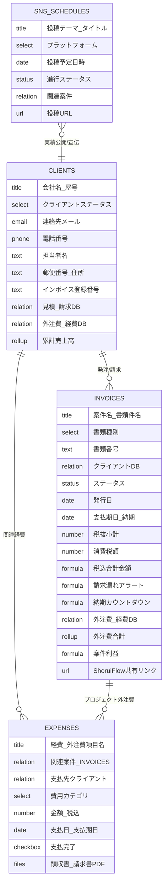

# Notion B2B業務管理テンプレート データベース構造設計書

本設計書は、マイクロSaaS「ShoruiFlow（書類フロー）」のデータ構造と完全に連動し、案件管理・請求漏れ防止・外注費管理・SNSマーケティングを一元化するためのNotionデータベース定義書です。

---

## 1. データベース全体リレーション構造

---

## 2. データベース別プロパティ詳細定義

### DB-1: 案件・クライアントDB (`Clients & Partners`)
| プロパティ名 | プロパティ型 | 設定値 / オプション | 説明 |
| :--- | :--- | :--- | :--- |
| **会社名・屋号** | Title | - | クライアント企業名または個人事業主屋号 |
| **ステータス** | Select | リード, 商談中, 既存顧客, 休眠, パートナー/外注先 | 取引関係の状態 |
| **担当者名** | Text | - | 窓口担当者氏名（例: 佐藤 健一 様） |
| **メールアドレス** | Email | - | 連絡先メール |
| **電話番号** | Phone | - | 電話番号 |
| **郵便番号・所在地** | Text | - | 請求先住所（ShoruiFlowの取引先住所と連動） |
| **インボイス登録番号** | Text | - | 取引先のT+13桁インボイス番号 |
| **案件・請求履歴** | Relation | リレーション先: `Invoices & Estimates` | 該当顧客の全案件・書類 |
| **関連外注費** | Relation | リレーション先: `Expenses & Subcontracting` | パートナーとして発注した経費 |
| **累計売上高** | Rollup | リレーション: `案件・請求履歴`, プロパティ: `税込合計金額`, 計算: `合計` | 生涯取引総額（LTV）を自動集計 |

---

### DB-2: 見積・請求ステータスDB (`Invoices & Estimates`)
*ShoruiFlowマイクロSaaSの出力項目と完全同期*

| プロパティ名 | プロパティ型 | 設定値 / オプション | 説明 |
| :--- | :--- | :--- | :--- |
| **案件名・書類件名** | Title | - | 例: `Webシステム開発および運用支援の件` |
| **書類種別** | Select | 1. 見積書, 2. 発注書, 3. 納品書, 4. 請求書 | ShoruiFlowの4種書類に対応 |
| **書類番号** | Text | - | 例: `EST-2026-001`, `INV-2026-001` |
| **クライアント** | Relation | リレーション先: `Clients & Partners` (単一選択) | 取引先情報 |
| **ステータス** | Status | 下書き, 提出済/見積中, 受注/着手, 請求済/入金待ち, 入金完了, 失注 | 業務進捗管理 |
| **発行日** | Date | - | 書類の発行日（YYYY-MM-DD） |
| **支払期日・納期** | Date | - | 支払期日または有効期限 |
| **税抜小計** | Number | 通貨フォーマット: `Japanese Yen (¥)` | 税抜金額 |
| **消費税額** | Number | 通貨フォーマット: `Japanese Yen (¥)` | インボイス消費税額 |
| **税込合計金額** | Formula | `prop("税抜小計") + prop("消費税額")` | 請求総額 |
| **請求漏れアラート** | Formula | *Formula 2.0仕様（後述）* | 納品後未請求や期日超過を検知 |
| **納期カウントダウン** | Formula | *Formula 2.0仕様（後述）* | 「本日締切」「残り3日」等の可視化 |
| **外注費・仕入** | Relation | リレーション先: `Expenses & Subcontracting` | 当該案件に紐づく外注費 |
| **外注費合計** | Rollup | リレーション: `外注費・仕入`, プロパティ: `金額（税込）`, 計算: `合計` | 原価の自動集計 |
| **粗利益（粗利額）** | Formula | `prop("税込合計金額") - prop("外注費合計")` | 案件ごとの実質利益 |
| **ShoruiFlowリンク**| URL | - | ShoruiFlowのハッシュ共有URL（ワンクリックで書類再現） |

---

### DB-3: 外注費・経費DB (`Expenses & Subcontracting`)
| プロパティ名 | プロパティ型 | 設定値 / オプション | 説明 |
| :--- | :--- | :--- | :--- |
| **経費・外注費項目名** | Title | - | 例: `デザインモック制作委託`, `サーバー代` |
| **紐づく案件** | Relation | リレーション先: `Invoices & Estimates` | どの案件の原価かを紐付け |
| **支払先** | Relation | リレーション先: `Clients & Partners` | パートナー企業またはツール提供元 |
| **カテゴリ** | Select | 外注費, クラウド/ツール費, 広告宣伝費, 旅費交通費, 雑費 | 確定申告・決算対応 |
| **金額（税込）** | Number | 通貨フォーマット: `Japanese Yen (¥)` | 支払金額 |
| **支払予定日** | Date | - | 支払期日 |
| **支払ステータス** | Status | 未払い, 支払処理中, 支払完了 | キャッシュアウト管理 |
| **証憑ファイル** | Files & media | - | 領収書PDF、請求書画像 |

---

### DB-4: SNS投稿スケジュールDB (`Content & Marketing`)
| プロパティ名 | プロパティ型 | 設定値 / オプション | 説明 |
| :--- | :--- | :--- | :--- |
| **投稿テーマ・タイトル** | Title | - | 例: `新機能「ワンクリック変換」の解説ポスト` |
| **プラットフォーム** | Select | X (Twitter), Note, YouTube, ブログ, LinkedIn | 発信媒体 |
| **投稿予定日時** | Date | 日時形式 (Include time: ON) | カレンダー表示用 |
| **進行ステータス** | Status | ネタ出し, 執筆中, レビュー完了, 予約投稿済, 投稿完了 | 進捗管理 |
| **関連案件・実績** | Relation | リレーション先: `Invoices & Estimates` | 制作実績としての公開許可紐付け |
| **公開URL** | URL | - | 実際の投稿リンク |
